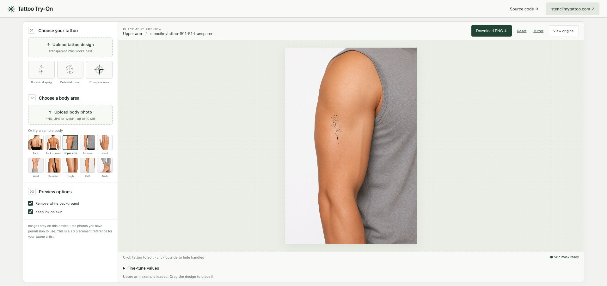

# Tattoo Try-On

[English](README.md) · **简体中文**

一个开源的 **2D 纹身试穿编辑器**。选择身体照片和纹身图案，直接在预览区移动、缩放和旋转图案，再保存 PNG，与纹身师讨论位置和构图。

[在 stencilmytattoo.com 体验在线纹身试穿 ↗](https://stencilmytattoo.com/try-on-tattoo?utm_source=github&utm_medium=referral&utm_campaign=tattoo_try_on_open_source&utm_content=readme_demo_zh)

在线试穿是 **Stencil My Tattoo** 的一部分，该站也提供纹身线稿处理和设计工具。本仓库专注于试穿编辑器，以独立的纯前端实现分享交互方式和示例资源；运行时不需要账号或 API Key。



## 功能

- 使用 **10 张身体部位示例照片**，或上传自己的照片。
- 选择 3 个原创 SVG 示例图案，或上传 PNG、JPG、WebP。
- 拖动图案移动位置，拖动四角等比缩放，拖动顶部手柄旋转。
- 点击图案外或按 Esc 隐藏操作框，再点击图案继续调整。
- 支持镜像；预览下方可展开大小、角度、透明度和位置的数值微调。
- 根据亮度去除近白色背景并增强墨线，保留原图透明度。
- 在本机识别皮肤区域，让衣服、头发和照片背景遮住对应图案。
- 对比原图，导出无水印 PNG；也可用键盘方向键移动图案。

不需要摄像头、账号、credits、付费服务或服务端图片处理，也没有接入统计 SDK。

## 本地运行

需要 **Node.js 22.12+** 和 pnpm。

```sh
git clone https://github.com/lorishui/tattoo-try-on.git
cd tattoo-try-on
pnpm install
pnpm dev
```

打开 **http://127.0.0.1:4207**。

- 约 16MB 的识别模型已放在 `public/models/`，随仓库提供，无需另行下载。
- 安装依赖时会将 MediaPipe WASM 运行文件自动复制到 `public/wasm/`。
- 如果安装时禁用了脚本，请在启动前执行 `node scripts/copy-wasm.mjs`。
- 首次安装依赖需要网络；运行识别时，模型和运行文件由本地服务提供，不依赖外部 CDN。

```sh
pnpm test          # 图片校验、坐标变换、墨线处理和遮罩测试
pnpm format:check
pnpm build         # TypeScript 检查和生产构建
pnpm preview       # 在同一本地端口预览生产构建
```

`dist/` 是静态应用，可部署到域名根目录或子目录。本仓库没有自动配置线上部署。

## 使用步骤

1. 选择或上传纹身图案，透明 PNG 效果更直接。
2. 选择示例身体部位，或上传皮肤区域清晰的身体照片。
3. 在照片上移动、缩放、旋转图案。点击图案外或按 Esc 隐藏操作框；再次点击图案继续编辑。
4. 根据需要展开 **Fine-tune values**。画布获得焦点后，可按 Enter 选中图案，再用方向键移动；Shift 加方向键可增大移动步长。
5. 保持 **Keep ink on skin** 开启以应用皮肤遮罩。识别失败时会明确提示，并提供无遮罩预览和 Retry；也可主动关闭遮罩。
6. 用 **View original** 查看原图，点击预览工具栏的 **Download PNG** 保存结果。

桌面工作区按视口高度适配。移动端首屏优先显示预览与下载，通过 **Photos & designs** 跳到下方图案选择区。

上传支持 PNG、JPEG、WebP，单个文件不超过 10MB、3200 万像素。出于输入格式限制，不接受用户上传 SVG；仓库中的三个 SVG 是随项目提供的可信原创示例。

导出使用 1200 × 1800 参考画布。身体照片等比放入画布，不拉伸；图案在放置前将宽度限制到 1400px。

## 处理方式与隐私

上传的图片只解码到浏览器内存，不发送到图片服务，不存储到服务端或 localStorage；刷新页面会清除上传内容。

浏览器仍会向应用所在的服务器请求网页、示例图片、模型和 WASM 文件。运行资源均为同源加载，没有外部 CDN 依赖或跟踪 SDK。

图像变换和合成由 Canvas 2D 完成。MediaPipe Selfie Multiclass 模型识别身体皮肤与面部皮肤。CPU 识别在每张身体照片加载时执行，目前运行于主线程，较慢设备可能短暂停顿。

## 效果边界

这是**平面照片上的位置预览**，不提供实时 AR、3D 曲面包裹、实际尺寸测量或纹身愈合效果预测，也不替代可打印的纹身线稿。

遮罩可能误判深色或浅色皮肤、衣服覆盖处、裁切区域和光线较差的照片。少量示例照片不代表所有体型或肤色。最终位置、图案细节和纹身可行性仍应与纹身师确认。

去白底主要面向线稿；浅色图案可以关闭该选项。

## 复用示例资源

`public/body-parts/manifest.json` 记录尺寸、原始 SHA-256 和来源说明。身体照片由 Stencil My Tattoo 提供，其所有者已授权用于本独立公开项目。原项目有 AI 图片生成说明，但没有逐张记录具体模型或提供方，不能将这些图片视为临床数据集或具有代表性的性能证据。

身体照片在权利持有范围内以 **CC BY 4.0** 提供。请注明“Stencil My Tattoo — demo body-part images”、链接许可证，并标明修改。正常署名即可，**不强制添加 SEO 链接或徽章**。

原创 SVG 和新编写的应用代码使用 MIT 许可证。品牌名称与 Logo 不包含商标使用授权。

## 项目背景

这个项目来自开发 [stencilmytattoo.com](https://stencilmytattoo.com/?utm_source=github&utm_medium=referral&utm_campaign=tattoo_try_on_open_source&utm_content=readme_background_zh) 纹身预览功能的实践。

将独立编辑器和可复用示例公开，是希望开发者能更方便地尝试在浏览器本地实现纹身位置编辑。欢迎改进可访问性、皮肤遮罩、浏览器兼容性，或补充有适当授权的身体照片。

## 许可证

- 新编写的应用代码、文档和原创示例 SVG：[MIT](LICENSE)。
- 身体示例照片：[CC BY 4.0](public/body-parts/LICENSE.md)。
- Google MediaPipe 模型、运行库和 WASM：Apache 2.0，详见[第三方声明](THIRD_PARTY_NOTICES.md)。

没有导入 ShipAny 源码、商业模板组件、鉴权或支付代码，以及原商业仓库的用户图片或 Git 历史。

## 与在线工具的渲染兼容性

以 Stencil My Tattoo 在线工具的亮度去白底、墨线处理、96% 默认透明度、身体部位预设和 1200 × 1800 输出为参考。

两边均使用 MediaPipe Tasks Vision 1.0.1、同一 CPU 模型、1% 最低皮肤占比和 1px 遮罩柔化；本项目将运行文件保留在本地。

编辑预览使用普通透明图层合成；PNG 导出使用正片叠底和最终遮罩，与在线工具的两条路径分别对应，因此预览和下载的颜色可能不同。本项目用 Canvas 实现，在线工具用 Fabric，细线边缘仍有栅格化差异。验证范围和结果见[实际效果对照](docs/RENDER_PARITY.md)。

## 作者的其他项目

[Burning Bridges Studio](https://burningbridgesstudio.com/) 是同一作者的另一个项目。
