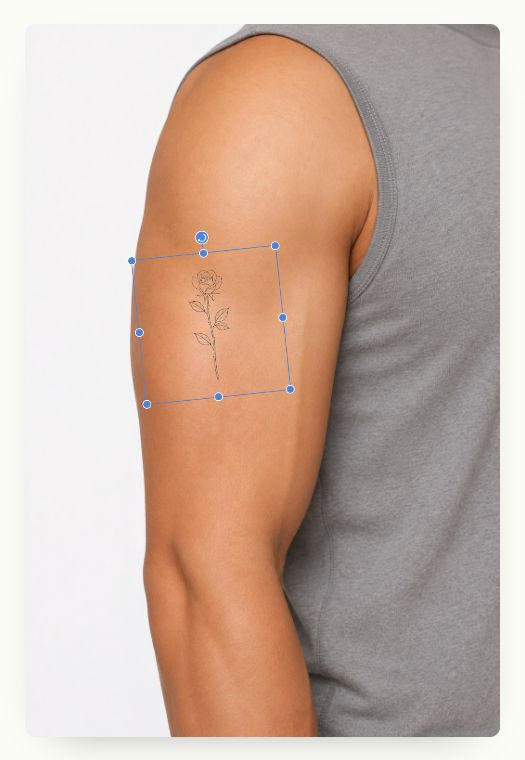

# Hosted rendering comparison — 2026-10-20

The reference is the real production `https://stencilmytattoo.com/try-on-tattoo`
opened in the existing Chrome session, not a reconstructed or mocked renderer.
The demo was tested at `http://127.0.0.1:4207` with the same PNG uploads and
unmodified body-preset placement. No generation API or credits were used.

## Aligned behavior

| Setting                    | Hosted baseline and demo                                                                                                          |
| -------------------------- | --------------------------------------------------------------------------------------------------------------------------------- |
| Reference/export frame     | 1200 × 1800; body photo contained without stretching                                                                              |
| Uploaded tattoo processing | Width capped at 1400; perceptual luminance; white threshold 235, solid-ink threshold 90; preserve input alpha and darken deep ink |
| Default opacity            | 96%                                                                                                                               |
| Initial placement          | Hosted coordinates, scale and rotation for all 10 body presets; normalized for the demo controls                                  |
| Segmentation               | Same model bytes; Tasks Vision 1.0.1; CPU; skin classes 2/3                                                                       |
| Skin fallback              | Skin ratio below 1% gives an explicit unmasked fallback                                                                           |
| Mask edge                  | 1px blur at 1200 × 1800                                                                                                           |
| Editing preview            | Normal transparent-layer composition over the body photo                                                                          |
| Download                   | Multiply composition, including the hosted final mask pass; controls excluded                                                     |

The two hosted compositing paths are intentionally matched separately. Editing
and download can differ in color. This change does not modify that behavior in
the commercial application.

## Actual PNG comparisons

Both images in each pair are 1200 × 1800 RGBA. Metrics below are absolute RGB
channel differences on a 0–255 scale. Whole-frame averages are dominated by the
identical body photo; they are **not quality scores or conversion evidence**.
The difference bounding-box average excludes the rest of the photo, but still
contains unchanged pixels inside the box.

| Input / body                 | Whole-frame mean | Difference-box mean | Result                                                                                            |
| ---------------------------- | ---------------: | ------------------: | ------------------------------------------------------------------------------------------------- |
| White rose / back            |          0.05450 |               2.008 | Position, scale, color treatment and output geometry aligned; fine-edge raster differences remain |
| White rose / upper arm       |          0.03807 |               2.729 | Position, scale, color treatment and output geometry aligned; fine-edge raster differences remain |
| Color rose / upper arm       |          0.03723 |               2.669 | Position, scale, color treatment and output geometry aligned; fine-edge raster differences remain |
| Transparent rose / upper arm |          0.03807 |               2.729 | Position, scale, color treatment and output geometry aligned; fine-edge raster differences remain |

Exact filenames, hashes and raw metrics are in [render-parity.json](render-parity.json).
PNG files remain in the local Downloads folder and are not copied into the public
asset library. The demo uses Canvas 2D; the hosted tool uses Fabric. Their caching,
transforms and image interpolation leave small differences at fine strokes, so
this is behavioral/visual alignment, not pixel identity.

## Additional real-browser checks

- Color rose dragged across the upper-arm/clothing boundary in both apps:
  ink is visible on skin and clipped over the shirt. Manual placements were
  visually compared; those dragged positions are not part of the numeric table.
- 390 × 844: page width remains 390px; preview and download fit the first screen.
- Non-body PNG as body input: visible unmasked fallback and Retry; returning to
  the upper-arm preset restores a ready skin mask.
- Existing direct manipulation, selection hiding, mirror and original comparison
  are retained. This pass does not establish real-device touch performance.
- Body resources and the segmentation model match the commercial source bytes.
- No server-side image upload, analytics, account or paid generation was added.

This comparison was recorded before initial publication. See Git history for the
current publication state. No hosted deployment was performed.
